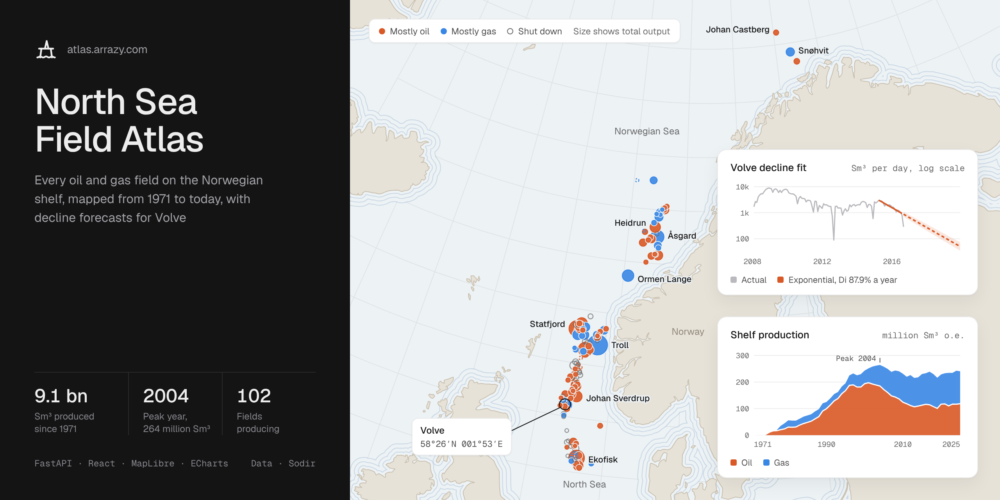

# North Sea Field Atlas

[](https://atlas.arrazy.com)

An interactive atlas of oil and gas production on the Norwegian Continental Shelf, built
on open data from the Norwegian Offshore Directorate (Sodir).

## Features

- **The shelf by year.** A map of all 142 fields with a year slider. The shelf has
  produced 9.1 billion Sm³ of oil equivalent since 1971. Output peaked in 2004. Gas was
  30% of output in 2004 and 51% in 2025.
- **One field up close.** Monthly production, investment and a decline curve forecast
  for any field. For Volve, the best fit says about 1.6 million more barrels were left
  when it shut down in 2016.
- **How fields age.** 85 fields lined up by age. The typical field reaches its best year
  in year 3 and stays near it for 2 years.

## Data

Sodir production data up to August 2026, downloaded once in November 2026. Volve's
recovery rate comes from Equinor. The coastline is from Natural Earth.

Data from the Norwegian Offshore Directorate (Sodir), Norwegian Licence for Open
Government Data (NLOD).

## Run it locally

```bash
cd backend && uv run uvicorn api.app:app --reload
```

```bash
cd frontend && npm install && npm run dev
```

Then open http://localhost:5173.
